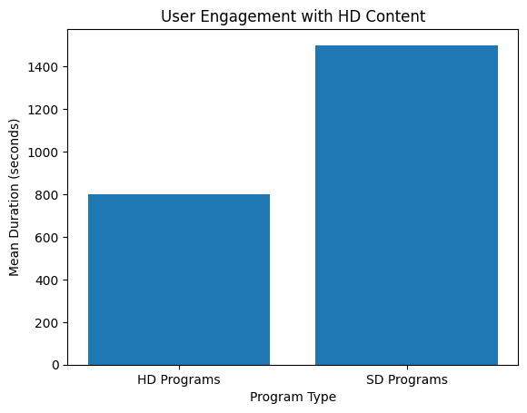
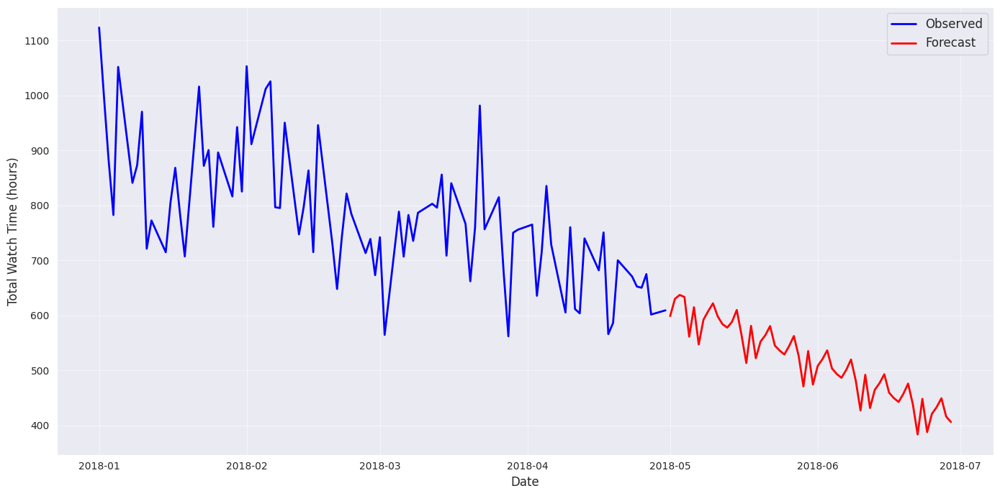

# STC TV Data Analysis

Analysis of viewing data from STC TV (Jawwy), completed as a Misk virtual experience. The work covers viewing behavior, a watch-time forecast, and a recommendation system.

## Tasks

| Notebook | Question | Method |
|---|---|---|
| [`stcTask1.ipynb`](stcTask1.ipynb) | What do people watch, and how does HD viewing differ from SD? | Data cleaning, grouping, Plotly and Matplotlib charts |
| [`STCtask2.ipynb`](STCtask2.ipynb) | How many hours will customers watch in the next 60 days? | SARIMA time-series model with statsmodels |
| [`STCtask3.ipynb`](STCtask3.ipynb) | What should be recommended to people who watched *Moana*? | SVD collaborative filtering with scikit-surprise |

## Results

### Viewing behavior

Task 1 uses about 1 million viewing records. HD programs had a shorter mean viewing duration than SD programs, at about 800 seconds compared with about 1,500 seconds.



### Watch-time forecast

Task 2 fits a SARIMA(0,1,1)(1,1,1,12) model to daily watch hours and forecasts 60 days from May 2018. The forecast continues the downward trend in the data. The notebook does not measure forecast accuracy.



### Recommendations

Task 3 trains an SVD model on user ratings. For people who watched *Moana*, the top five results are *Borj Al Oloum*, *Wolverine and the X-Men*, *Slugterra*, *House Alone*, and *Pingu*. Four of the five are animation.

## How to run

The datasets are not included in this repository, so the notebooks show saved results. To run them again, you need the STC TV dataset files from the Misk virtual experience.

```bash
git clone https://github.com/JumanahAlmatrood/STC-Data-Analysis-Tasks.git
cd STC-Data-Analysis-Tasks
pip install jupyter pandas numpy matplotlib plotly statsmodels scikit-surprise openpyxl pyxlsb
jupyter notebook
```

Put the dataset files next to the notebooks and update the file paths in the `read_excel` cells.

## Tools

Python, pandas, NumPy, Matplotlib, Plotly, statsmodels, scikit-surprise
